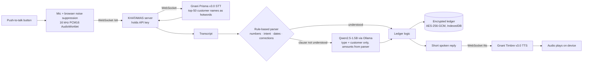

# KHATAWAS — The Voice Ledger for Kirana Stores

> Push-to-talk. Say it once, the khata is updated. No typing, no tapping, no stopping the sale.

**Team:** ANTHROMINDS · **Team ID:** 4FFAF822E514 · **College:** Dayananda Sagar Academy of Technology and Management & Dayananda Sagar College of Engineering
**Hackathon:** Gnani Voice Hackathon — Voice Khata for Kirana Stores
**Demo video:** _add link_ · **Live demo:** _add link_

---

## The problem

Kirana owners record *udhaar* (informal credit) on paper while serving a queue. Khatabook-style apps need tapping and typing, which nobody does at peak hours. Voice solutions that exist break in noisy streets and in code-mixed speech (Hindi + regional + English).

## What KHATAWAS does

A shopkeeper holds a button and talks naturally, the way they already speak:

| Shopkeeper says | KHATAWAS does |
|---|---|
| "Ramesh ka 340 udhaar, kal 200 diya tha" | Books ₹340 credit today and a ₹200 payment dated yesterday, for Ramesh |
| "Teen sau chaalis" / "three forty" / "340" | All become 340 |
| "Nahi, 430" | Corrects the last entry to ₹430 |
| "Ramesh ka 500 udhaar" (two Rameshes exist) | Asks: "Kaun sa Ramesh? Ramesh Kumar ya Ramesh Gupta?" |
| "Aaj kitna udhaar gaya?" | Speaks the total credit given today |
| "Ramesh ka total?" | Speaks Ramesh's balance |

## How it works



**Design choices**

- **Deterministic first, LLM only as a fallback.** The rule-based parser handles the judged cases in about 2 ms with no model call, so results are predictable. Qwen2.5-1.5B is called only when the parser cannot understand a sentence. If the model is offline or slow the sale still completes.
- **Amounts in any spoken form.** Digits, Hindi number words (up to 99 plus *sau/hazaar/lakh*), English words, colloquial "three forty", and *dedh/dhai/saade* forms.
- **Hotword biasing.** The shop's customer names are sent to Prisma so proper nouns are recognised in code-mixed speech.
- **API key never reaches the browser.** The browser talks to our own server (`/stt`, `/tts`), which talks to Gnani.
- **Spoken answers stream.** Timbre audio chunks are scheduled for playback as they arrive, so the first sound plays before the whole reply is generated.

## Gnani and Qwen: what each one does

KHATAWAS uses **two AI models for two different jobs**. Gnani handles the voice; Qwen is a small local safety net for sentences the rules cannot understand.

| | **Gnani Prisma v3.0** | **Gnani Timbre v3.0** | **Qwen2.5-1.5B** |
|---|---|---|---|
| Job | Speech to text | Text to speech | Reads unclear sentences |
| Runs where | Gnani cloud (WebSocket) | Gnani cloud (WebSocket) | Locally, on the same machine as our server, via Ollama |
| Needs internet | Yes | Yes | No |
| Input | Push-to-talk audio (16 kHz PCM16), plus customer names as hotwords | The short reply sentence | Only the clause the rules could not parse |
| Output | Transcript, usually in Hindi script, with English words kept | Streaming audio, played as it arrives | JSON: entry type and customer name |
| Used on | Every utterance | Every reply | Only some utterances (2 of 32 clean and 4 of 32 noisy test runs) |
| Code | `server/gnani.js` | `server/gnani.js` | `src/llm.js` |

**Gnani settings used:** Prisma `model=prisma-v3.0`, `format=codemix`, `language_code=hi-IN`, up to 50 customer names as `keyterms`, 1024-byte PCM frames with a `commit` at the end of speech. Timbre `model=timbre-v3.0`, voice `Shivani`, language `hi-en` (Hinglish), 24 kHz raw PCM.

**How a sentence flows**

1. The shopkeeper holds the button; Prisma returns the transcript.
2. The **rule-based parser** reads it first (numbers, credit vs payment, dates, corrections). This takes about 1 ms and is fully predictable.
3. If, and only if, a clause is not understood, that clause goes to **Qwen**.
4. The ledger applies the entries and builds a short reply; **Timbre** speaks it.

**Why Qwen is boxed in.** A 1.5B model got 3 of its first 5 test sentences wrong when left unguarded (it read goods-on-credit as a payment, turned 300 into 10, and invented a question from noise). So it is only allowed to choose the *type* of entry and the *customer*. Specifically:

- **Amounts never come from Qwen.** They are read by the deterministic number parser from the same clause.
- A credit or payment with no spoken amount, or no customer, is rejected.
- A customer name Qwen returns must actually appear in the clause (it cannot invent people).
- A question answer is rejected unless the clause contains a question word.
- If Ollama is down or slow (4 s timeout), Qwen returns nothing and the app asks the shopkeeper to repeat.

**Honest status of Qwen:** tested from the command line and inside the benchmark (`scripts/benchmark.js`), where it recovered a ₹400 credit from "Geeta ke khate me chaar sau ka atta chadha do". It has not yet been exercised through the browser UI, and Ollama must be running on the machine that runs `npm start`. It is a fallback, not the main path.

No telephony, no hosted end-to-end agent platform, no voice cloning. Orchestration is custom (`src/pipeline.js`).

## Responsible AI

- **Discloses it is an AI:** the first spoken reply of every session begins "Main ek AI sahayak hoon" (Hindi), and the header also shows "Main ek AI hoon · I am an AI assistant".
- **Privacy:** the ledger is encrypted at rest with AES-256-GCM (WebCrypto). The key is a non-extractable `CryptoKey` stored in IndexedDB, so page JavaScript cannot read the raw key. Nothing is synced anywhere.
- **Delete on demand:** the **Delete all data** button wipes both the ciphertext and the key.
- **What leaves the device:** audio of the push-to-talk utterance goes to Gnani Prisma for transcription, and reply text goes to Gnani Timbre. The ledger itself never leaves the device.
- **No lending or pressure language:** the app only records, corrects and reports. There are no automated reminders.
- **Synthetic data only** for tests and demo. No real customer data.
- **Secrets:** the API key lives in a gitignored `.env`.

## Run it

Requirements: Node 20+. Optional: [Ollama](https://ollama.com) for the Qwen fallback.

```bash
git clone <this repo> && cd khatawas
npm install

# 1. Gnani credentials (gitignored)
cp .env.example .env     # then fill in GNANI_API_KEY (URLs are prefilled)

# 2. Offline fallback model (optional, ~1 GB)
ollama pull qwen2.5:1.5b

# 3. Start
npm start                # http://localhost:3000
npm test                 # parser + ledger tests
npm run live-test        # real Gnani round trip (uses your credits)
```

Open the page on a phone or laptop, hold the big button (or the space bar), speak, release. You can also type a sentence in the box to test the parser without a microphone.

**Dev mode:** if `.env` has no Gnani settings the app falls back to the browser's built-in speech recognition and voice, and the footer shows `DEV MODE`. This is for development only and is not the submission path.

## Project layout

```
src/numbers.js     spoken-number parsing (Hindi / Hinglish / English)
src/parser.js      intents, customers, relative dates, corrections
src/ledger.js      ledger logic, clarification questions, spoken replies
src/llm.js         Qwen2.5-1.5B fallback via Ollama (strict JSON output)
src/pipeline.js    transcript -> parser -> (Qwen) -> ledger -> reply
server/index.js    static files, /ollama proxy, /stt and /tts WebSockets
server/gnani.js    the only file that knows Gnani's wire protocol
public/            UI, mic capture worklet, encrypted store, speech clients
test/              node:test suites
```

## Status and honest limitations

- **Working and tested (21 automated tests + a live benchmark):** number parsing, credit/payment direction, relative dates, multi-entry sentences, spoken corrections, duplicate-name clarification, queries, Hindi-script input, phonetic name matching.
- **Measured with real Gnani calls** (details and caveats in [`docs/benchmark.md`](docs/benchmark.md)): on 32 synthetic test sentences, 32/32 fully correct in clean speech and every amount exact; 20/32 fully correct and 25/29 amounts exact with synthetic 5 dB shop noise. Prisma finalises a transcript about 0.3 s after speech ends; Timbre's first reply audio arrives in about 0.43 s (median). The test audio is synthetic and the parser was tuned on part of it, so these are not field results.
- **Gnani integration (verified live):** `server/gnani.js` follows the Vachana docs (Prisma v3.0 STT WebSocket with `keyterms` hotwords and `format=codemix`; Timbre v3.0 TTS WebSocket). `npm run live-test` speaks a sentence with Timbre, transcribes it with Prisma and parses it. In our runs Prisma returned the transcript about 130-300 ms after the audio was sent and Timbre's first audio arrived in about 440-750 ms. These were short synthetic sentences over a home connection, not a noisy shop, so treat them as indicative, not as a latency guarantee.
- **Prisma returns final transcripts only** (no partial/interim results), so the screen shows the text after you release the button.
- **Hindi script:** Prisma answers in Devanagari ("तीन सौ चालीस रुपये उधार"), so the parser understands both Devanagari and romanized Hinglish. Customer names heard in Devanagari that were never typed or biased as hotwords are stored as heard.
- **Qwen fallback (tested on a small set):** Qwen2.5-1.5B answers in about 260-350 ms locally. On our first 5 messy sentences, unguarded, it got 3 wrong (goods-on-credit read as payments, amount 10 instead of 300, a made-up query for gibberish). So it is guard-railed: Qwen may only choose the kind and the customer; amounts always come from the deterministic number parser; writes with no spoken amount or no customer are rejected; query answers are rejected unless the sentence contains a question word. After this and a few-shot prompt it handled the one sentence the rules could not ("Geeta ke khate me chaar sau ka atta chadha do" -> credit 400) and produced nothing for gibberish. This is a handful of sentences, not a benchmark, and Qwen is a fallback, not the main path.
- **Noise robustness:** this build uses the browser's built-in noise suppression and echo cancellation. Tested only against synthetic noise (see benchmark), not real shop recordings; under noise Prisma sometimes mishears names or inserts words, which the app cannot recover from. Native RNNoise/SpeexDSP is on the roadmap below, not shipped.
- **Platform:** a web app that runs on a low-end phone's browser. A native Android build is future work.
- **Parser coverage:** designed for Hindi/Hinglish/English. Regional-language number words beyond Hindi are not covered yet.

## Roadmap

1. Verify and tune against Gnani Prisma/Timbre with measured end-to-end latency.
2. Evaluate Qwen fallback accuracy on a synthetic noisy test set.
3. Native Android shell with RNNoise + SpeexDSP (JNI), SQLCipher and Android Keystore, as in the original design.
4. Opt-in, polite payment reminders.
5. More regional languages.

## License

MIT, see `LICENSE`.
